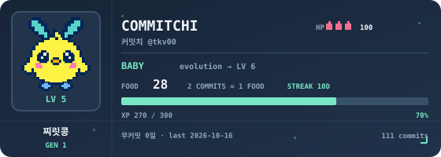

# Commitchi

<picture>
  <source media="(prefers-color-scheme: dark)" srcset="assets/commitchi.svg">
  <source media="(prefers-color-scheme: light)" srcset="assets/commitchi-light.svg">
  
</picture>

Commitchi is a small GitHub README pet powered by your public commit activity. The pet grows when you feed it, changes stage as it levels up, and dies after a long inactive period. A later commit starts a new generation.

The source repository can stay private. The updater reads GitHub contribution data, renders the badge, and publishes only the two SVG assets to a branch in the public profile repository.

[한국어 가이드](docs/README.ko.md)

## Add the badge to a profile README

After the publisher has been configured, add the dark badge to the target README:

```md

```

To let GitHub choose a light or dark asset, use the optional theme-aware variant:

```html
<picture>
  <source media="(prefers-color-scheme: dark)" srcset="https://raw.githubusercontent.com/tkv00/tkv00/commitchi-assets/assets/commitchi.svg">
  <source media="(prefers-color-scheme: light)" srcset="https://raw.githubusercontent.com/tkv00/tkv00/commitchi-assets/assets/commitchi-light.svg">
  
</picture>
```

The badge is a compact `560 × 200` SVG. It includes the current level, stage, food, XP, health, streak, last activity date, and total public commits.

## Game rules

- Two commits produce one food. An odd commit is carried into the next day.
- The updater feeds at most three meals per day.
- Each meal gives 10 XP. The next cumulative level threshold is `L × (L + 1) × 10`, where `L` is the current level.
- Growth stages appear at levels 1, 3, 6, and 10: `SEED`, `BABY`, `GROWN`, and `CROWN`.
- Three completed zero-commit days put the pet in the danger window. The fourth completed zero-commit day kills it.
- A commit during the one-day grace window saves the current generation.
- A commit after death starts a new generation. Lifetime commit and food counters remain visible in the saved state.

The date basis is the UTC calendar date returned by GitHub. The first successful update adopts the day on which it runs, so the pet does not invent history before adoption.

Only public repository contributions count by default. The profile repository itself is excluded through `excludeRepository` so publishing the badge does not feed the pet. Private contributions are intentionally unsupported in this version.

## Configure the project

Copy or edit `commitchi.config.json`:

```json
{
  "owner": "tkv00",
  "name": "커밋치",
  "excludeRepository": "tkv00/tkv00",
  "publicRepository": "tkv00/tkv00",
  "publicBranch": "commitchi-assets"
}
```

`owner` is the GitHub account whose contributions are measured. `excludeRepository` is compared case-insensitively with repository names. `publicRepository` and `publicBranch` identify the profile repository and branch that receive `commitchi.svg` and `commitchi-light.svg`.

When reusing the project for a different owner, preserve the old records and start with an empty `pet/data/` directory. The updater deliberately rejects a saved state belonging to another account.

## Local development

The project has no runtime dependency. Run the tests with Node.js:

```sh
npm test
```

Run an update with a GitHub token in the environment:

```sh
PET_OWNER=tkv00 PET_GITHUB_TOKEN="$GITHUB_TOKEN" npm run update
```

The updater validates the complete catch-up range before writing `pet/data/ledger.json`, `pet/data/state.json`, or the rendered SVG. If GitHub returns an error, pagination is incomplete, or the response is malformed, the previous state is kept. Each update rechecks a seven-day overlap to absorb corrected contribution data.

Preview the live badge and demo states locally:

```sh
npm run preview
```

## Publishing model

The source repository is private and is updated by GitHub Actions every four hours. The workflow runs the updater and calls the publisher only when `PUBLISH_DEPLOY_KEY` is present. Without that secret, the source repository still updates and the public assets are not pushed.

The publisher uses a dedicated deploy key to write the configured public profile repository. Configure the key as the repository secret `PUBLISH_DEPLOY_KEY`, and grant it write access to the target repository. The publishing script restricts its file changes to the configured asset branch and the two generated images. Key setup is required; publishing is not active until the secret is provisioned.

Do not put a GitHub token or private key in an image URL, README, commit, or issue. The raw image URLs above contain only the public repository and branch.

The current account plan does not support Pages for private repositories. This setup therefore publishes only the badge files to the public profile repository branch described above.

## Assets

- `assets/sprites/commitchi.png` is the source pixel sprite.
- `assets/commitchi.svg` is the dark theme badge generated from the current state.
- `assets/commitchi-light.svg` is the light theme badge generated from the current state.

The character is an original pixel asset made for Commitchi. The supplied mood reference informed the cheerful collectible direction; no reference character, layout, or trademark is copied.

## Contributing

See [CONTRIBUTING.md](CONTRIBUTING.md) for local checks and issue guidance.

## License

Commitchi code is available under the [MIT License](LICENSE). Documentation and generated assets are covered by the notices in that file.
